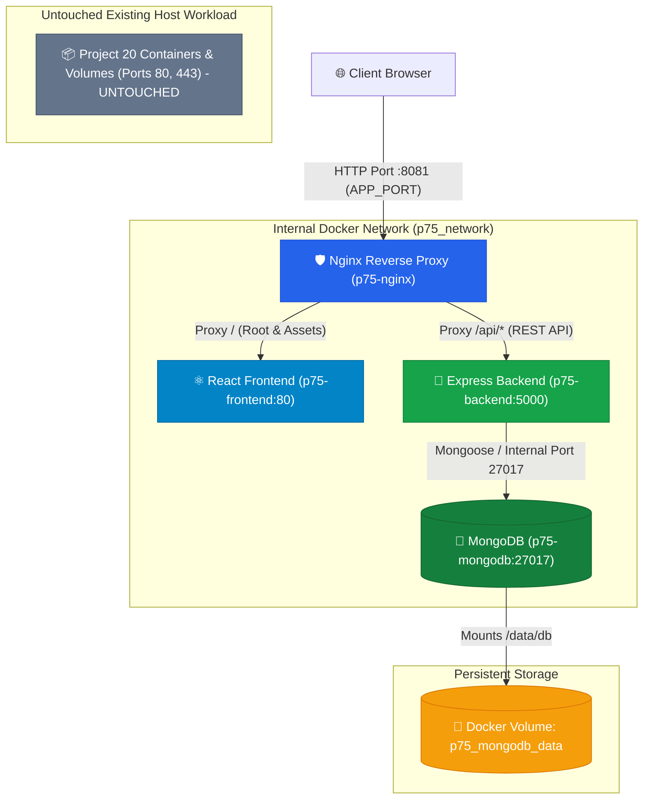

# Project 75 — Production Architecture (MERN Stack)

A production-grade, containerized Task Management application built with the MERN stack (MongoDB, Express.js, React, Node.js), Nginx reverse proxy, and Docker Compose. Engineered for high reliability, minimal resource footprint, and zero-downtime coexistence alongside existing cloud services on AWS EC2.

---

## Table of Contents

1. [Project Overview](#1-project-overview)
2. [Project Objectives](#2-project-objectives)
3. [Technology Stack](#3-technology-stack)
4. [Architecture Diagram](#4-architecture-diagram)
5. [Folder Structure](#5-folder-structure)
6. [Application Features](#6-application-features)
7. [API Documentation](#7-api-documentation)
8. [Prerequisites](#8-prerequisites)
9. [Local Setup Instructions](#9-local-setup-instructions)
10. [Environment Variables](#10-environment-variables)
11. [Docker Compose Instructions](#11-docker-compose-instructions)
12. [Testing Instructions](#12-testing-instructions)
13. [GitHub Upload Instructions](#13-github-upload-instructions)
14. [AWS EC2 Deployment Guide](#14-aws-ec2-deployment-guide)
15. [HTTPS Setup Requirements](#15-https-setup-requirements)
16. [Monitoring and Troubleshooting](#16-monitoring-and-troubleshooting)
17. [Security Considerations](#17-security-considerations)
18. [Cost-Saving Recommendations ($3 Budget)](#18-cost-saving-recommendations-3-budget)
19. [Known Limitations](#19-known-limitations)
20. [Final Deployment Verification Checklist](#20-final-deployment-verification-checklist)

---

## 1. Project Overview

Project 75 is a production-engineered Task Management Dashboard designed to showcase professional DevOps and full-stack software practices. The system deploys four discrete services (React frontend, Express REST API, MongoDB database, and Nginx reverse proxy) orchestrated via Docker Compose into an isolated container network.

### Multi-Project AWS Coexistence Model
In real-world cloud operations, multiple applications often share the same host infrastructure to conserve costs. Project 75 is specifically configured to deploy safely onto an existing Ubuntu EC2 host running another production workload (**Project 20**) without altering ports 80/443, modifying shared networks, or stopping existing containers.

---

## 2. Project Objectives

- **DevOps Excellence**: Demonstrates multi-stage Docker builds, health checks, dependency chaining, graceful shutdown, and container isolation.
- **Resource Efficiency**: Optimized for small AWS EC2 instances (t2.micro / t3.micro) with a memory ceiling under 600MB and zero paid AWS add-ons.
- **Safe Coexistence**: Implements strict namespace, port, and volume isolation so existing services (Project 20) remain untouched.
- **Resilient Full-Stack Architecture**: Provides complete CRUD capabilities, input validation, centralized error handling, and persistent storage.

---

## 3. Technology Stack

| Layer | Technology | Details |
| :--- | :--- | :--- |
| **Frontend** | React 18, Vite 5, JavaScript | Modern Single Page Application (SPA), CSS variables, mobile-responsive |
| **Web Server / Ingress** | Nginx 1.27 Alpine | Reverse proxy, static asset caching, gzip compression, security headers |
| **Backend API** | Node.js 20, Express 4 | RESTful architecture, centralized error handling, non-root user execution |
| **Database** | MongoDB 7.0 | Pinned version, WiredTiger cache capped at 256MB, persistent named volume |
| **Orchestration** | Docker & Docker Compose | Dedicated bridge network `p75_network`, healthcheck dependencies |
| **Testing** | Jest, Supertest | Unit & integration tests for all API endpoints and health checks |

---

## 4. Architecture Diagram



### Request Flow
1. **Frontend Request**: The browser requests `http://<EC2_IP>:8081/`. Nginx proxies this internally to `http://frontend:80`.
2. **API Request**: The React application sends asynchronous fetch requests to `/api/tasks`. Nginx proxies these directly to `http://backend:5000/api/tasks`.
3. **Database Access**: The backend queries `mongodb://mongodb:27017/taskdb` over the internal Docker network. Neither MongoDB nor the backend expose any ports to the public internet or EC2 host.

---

## 5. Folder Structure

```
production-architecture/
├── .env.example              # Environment variables template
├── .gitignore                # Git exclusion rules (secrets, node_modules)
├── docker-compose.yml        # Production multi-container orchestrator
├── README.md                 # Project documentation
├── backend/                  # Node.js & Express REST API
│   ├── .dockerignore
│   ├── Dockerfile            # Non-root Node 20 Alpine container
│   ├── package.json
│   ├── src/
│   │   ├── app.js            # Express application & middleware setup
│   │   ├── server.js         # HTTP server entrypoint & graceful shutdown
│   │   ├── healthcheck.js    # Container health probe
│   │   ├── config/
│   │   │   └── db.js         # Mongoose connection with exponential retry
│   │   ├── controllers/
│   │   │   └── taskController.js # CRUD business logic
│   │   ├── middleware/
│   │   │   ├── errorHandler.js   # Centralized error & 404 handler
│   │   │   └── validator.js      # Input & ObjectId validation
│   │   ├── models/
│   │   │   └── Task.js       # Task Mongoose schema & indexes
│   │   └── routes/
│   │       ├── healthRoutes.js # /api/health endpoint
│   │       └── taskRoutes.js   # /api/tasks REST endpoints
│   └── tests/
│       └── api.test.js       # Jest & Supertest test suite
├── frontend/                 # React & Vite Single Page App
│   ├── .dockerignore
│   ├── Dockerfile            # Multi-stage build (Node build -> Nginx serve)
│   ├── index.html            # HTML entrypoint
│   ├── nginx.conf            # Internal SPA routing configuration
│   ├── package.json
│   ├── vite.config.js
│   └── src/
│       ├── main.jsx          # React DOM entrypoint
│       ├── App.jsx           # Main application dashboard
│       ├── components/
│       │   ├── ConfirmModal.jsx # Deletion safety modal
│       │   ├── HealthBadge.jsx  # Live API/DB connectivity indicator
│       │   ├── Notification.jsx # Feedback toast alerts
│       │   ├── TaskFilter.jsx   # All / Pending / Completed filter
│       │   ├── TaskForm.jsx     # Creation & editing form with validation
│       │   ├── TaskItem.jsx     # Individual task card
│       │   ├── TaskList.jsx     # Task list with empty/loading states
│       │   └── TaskStats.jsx    # Real-time counter metrics
│       └── styles/
│           └── index.css     # Clean responsive design
├── mongodb/
│   └── init-mongo.js         # Initialization script for application user
└── nginx/
    └── nginx.conf            # Ingress reverse proxy configuration
```

---

## 6. Application Features

- **Create Tasks**: Create a task with a validated `title` (1–120 characters) and optional `description` (up to 500 characters).
- **Read & List Tasks**: View all tasks sorted by most recently created.
- **Edit Tasks**: Inline updating of title and description.
- **Toggle Completion**: One-click checkbox to toggle tasks between Pending and Completed with instant UI response and rollback on network failure.
- **Delete with Confirmation**: Prevents accidental deletions with a modal prompt.
- **Filter Tasks**: Filter items by "All", "Pending", and "Completed".
- **Dynamic Counters**: Live counters displaying Total, Pending, and Completed tasks.
- **Health Badge**: Real-time system status widget polling `/api/health` to confirm server and database availability.
- **Error & Offline Resilience**: Friendly notifications and non-crashing UI when the backend or database is unreachable.

---

## 7. API Documentation

Base URL: `http://<HOST>:<APP_PORT>/api`

### Endpoints

| Method | Endpoint | Description | Request Body | Status Codes |
| :--- | :--- | :--- | :--- | :--- |
| `GET` | `/health` | Check backend & database health | None | `200` (Healthy), `503` (Degraded) |
| `GET` | `/tasks` | List all tasks (supports `?completed=true/false`) | None | `200`, `500` |
| `POST` | `/tasks` | Create a new task | `{ "title": "...", "description": "..." }` | `201`, `400`, `500` |
| `GET` | `/tasks/:id` | Retrieve a task by ID | None | `200`, `400` (Bad ID), `404` |
| `PUT` | `/tasks/:id` | Update task fields | `{ "title": "...", "description": "...", "completed": true }` | `200`, `400`, `404` |
| `DELETE` | `/tasks/:id` | Delete a task | None | `200`, `400`, `404` |

### Sample Responses

#### `GET /api/health`
```json
{
  "status": "healthy",
  "service": "project75-production-backend",
  "version": "1.0.0",
  "timestamp": "2026-10-23T18:00:00.000Z",
  "uptimeSeconds": 1420,
  "environment": "production",
  "database": {
    "status": "connected",
    "connected": true,
    "name": "taskdb"
  }
}
```

#### `POST /api/tasks`
```json
{
  "success": true,
  "message": "Task created successfully",
  "data": {
    "_id": "67193f218a5b281b3ce99120",
    "title": "Set up production Docker Compose",
    "description": "Configure multi-container orchestration with resource limits",
    "completed": false,
    "createdAt": "2026-10-23T18:05:00.000Z",
    "updatedAt": "2026-10-23T18:05:00.000Z"
  }
}
```

---

## 8. Prerequisites

### Local Development
- Node.js >= 18.0.0 (v20+ recommended)
- npm >= 9.0.0
- Docker Desktop with Docker Compose v2 (if running containers locally)
- Git

### AWS EC2 Deployment
- An active EC2 instance running Ubuntu 20.04 or 22.04 LTS (e.g., t2.micro or t3.micro).
- Docker and Docker Compose v2 installed.
- Inbound security group rule allowing TCP on port `8081` (or your configured `APP_PORT`).

---

## 9. Local Setup Instructions

### 1. Clone or Open the Workspace
```powershell
# Open terminal inside the project directory
cd c:\Users\varsh\OneDrive\Desktop\production-architecture
```

### 2. Configure Environment File
```powershell
# Copy the example environment configuration
Copy-Item .env.example .env
```

### 3. Running Backend Locally (Without Docker)
```powershell
# Navigate to backend directory
cd backend

# Install dependencies
npm install

# Run automated tests
npm test

# Run backend in development mode (requires local or cloud MongoDB)
npm run dev
```

### 4. Running Frontend Locally (Without Docker)
```powershell
# In a separate terminal, navigate to frontend directory
cd frontend

# Install dependencies
npm install

# Start Vite development server
npm run dev
# Frontend will be accessible at http://localhost:3000
```

---

## 10. Environment Variables

All configuration is driven by environment variables defined in `.env`:

| Variable | Default Value | Description |
| :--- | :--- | :--- |
| `APP_PORT` | `8081` | Host port on which Nginx listens. Avoids port `80` used by Project 20. |
| `NODE_ENV` | `production` | Node execution environment (`production` disables verbose error traces). |
| `MONGO_DATABASE` | `taskdb` | Application database name. |
| `MONGO_USER` | `appuser` | Restricted MongoDB user with readWrite role. |
| `MONGO_PASSWORD` | *(Secure string)* | Password for the restricted application user. |
| `MONGO_ROOT_USER` | `admin` | MongoDB administrative root user. |
| `MONGO_ROOT_PASSWORD`| *(Secure string)* | Password for root database administrative user. |
| `MONGO_URI` | *(Auto-assembled)* | Connection URI passed to the backend. |

> [!CAUTION]
> Never commit `.env` or production credentials to source control. `.env` is ignored by `.gitignore`.

---

## 11. Docker Compose Instructions

### Build and Launch Project 75
Always pass `-p production-architecture` to enforce strict project namespacing:
```bash
docker compose -p production-architecture -f docker-compose.yml up -d --build
```

### Inspect Container Health & Status
```bash
docker compose -p production-architecture ps
```

### View Real-Time Aggregated Logs
```bash
docker compose -p production-architecture logs -f
```

### Stop Project 75 Services (Preserves Database Data)
```bash
docker compose -p production-architecture down
```
> [!IMPORTANT]
> The above command stops only Project 75 containers and leaves the named volume `p75_mongodb_data` intact. It does NOT impact Project 20 containers.

---

## 12. Testing Instructions

### Backend Unit & Integration Tests
The backend test suite uses Jest and Supertest to validate:
- System health checks (`/api/health`)
- Task creation, title validation, whitespace rejection, and character limits
- Task retrieval by ID, 404 handling, and malformed ID rejection
- Task updates and completion toggles
- Task deletion with validation
- Route fallbacks (404 for unknown endpoints)

Execute tests locally:
```powershell
cd backend
npm test
```

### Frontend Build Verification
Verify that the React production bundle compiles cleanly:
```powershell
cd frontend
npm run build
```

### Docker Compose Configuration Validation
Validate the compose file syntax without starting containers:
```powershell
docker compose -p production-architecture -f docker-compose.yml config
```

---

## 13. GitHub Upload Instructions

Prepare and publish the repository safely without leaking credentials:

### 1. Initialize Git & Check Status
```powershell
cd c:\Users\varsh\OneDrive\Desktop\production-architecture
git init
git status
```

### 2. Verify Secrets Exclusion
Confirm that `.env` is NOT tracked:
```powershell
git status --ignored
# Verify .env is listed under "Ignored files"
```

### 3. Stage and Commit Files
```powershell
git add .
git commit -m "feat: complete production architecture for Project 75 (MERN Stack)"
```

### 4. Link Remote Repository and Push (User Approval Required)
```powershell
# Set main branch
git branch -M main

# Add your GitHub repository remote URL (replace with your repo URL)
git remote add origin https://github.com/<YOUR_GITHUB_USERNAME>/production-architecture.git

# Push to GitHub
git push -u origin main
```

---

## 14. AWS EC2 Deployment Guide

Follow this beginner-friendly, zero-downtime deployment guide to run Project 75 alongside Project 20 on your existing Ubuntu EC2 instance.

### Pre-Deployment Safety Rules
1. Never run `docker system prune`, `docker volume prune`, or `docker rm -f $(docker ps -aq)`.
2. Do not stop or modify containers named `project20-*`.
3. Keep Project 75 confined to port `8081` and project name `production-architecture`.

---

### Step 1: Connect to Your EC2 Instance
```bash
ssh -i /path/to/your-key.pem ubuntu@<YOUR_EC2_PUBLIC_IP>
```

---

### Step 2: Pre-Flight Environment Inspection

#### A. Verify Project 20 is Running
```bash
docker ps --format "table {{.Names}}\t{{.Status}}\t{{.Ports}}"
```
*Expected output: You should see `project20-nginx`, `project20-backend`, etc., active on ports 80/443.*

#### B. Check Available Memory & Disk Space
```bash
free -h
df -h /
```
*Ensure at least 350MB of available memory and 2GB of disk space. If memory is low, see [Cost-Saving Recommendations](#18-cost-saving-recommendations-3-budget) for adding a swap file.*

#### C. Confirm Port 8081 is Free
```bash
sudo ss -tulpn | grep 8081
```
*If this command produces no output, port 8081 is free to use.*

---

### Step 3: Clone Project 75 into a Dedicated Directory
```bash
cd ~
git clone https://github.com/<YOUR_GITHUB_USERNAME>/production-architecture.git project75
cd ~/project75
```

---

### Step 4: Create the Production `.env` File
```bash
cp .env.example .env
nano .env
```
Update passwords with secure values:
```bash
APP_PORT=8081
NODE_ENV=production
MONGO_DATABASE=taskdb
MONGO_USER=appuser
MONGO_PASSWORD=ProductionPassword_App75_#2026
MONGO_ROOT_USER=admin
MONGO_ROOT_PASSWORD=ProductionPassword_Root75_#2026
```
Save and exit (`Ctrl+O`, `Enter`, `Ctrl+X`).

---

### Step 5: Validate Docker Compose Configuration
```bash
docker compose -p production-architecture -f docker-compose.yml config
```
*Ensure Docker reports valid YAML syntax with your substituted `.env` values.*

---

### Step 6: Build and Launch Project 75
```bash
docker compose -p production-architecture -f docker-compose.yml up -d --build
```

---

### Step 7: Verify Running Containers & Health Status
```bash
docker compose -p production-architecture ps
```
You should see:
- `p75-mongodb` — `Up (healthy)`
- `p75-backend` — `Up (healthy)`
- `p75-frontend` — `Up (healthy)`
- `p75-nginx` — `Up (healthy)`

And confirm Project 20 is still running unaffected:
```bash
docker ps --filter "name=project20"
```

---

### Step 8: Update AWS Security Group
To view the application in your browser, allow inbound traffic on port `8081`:
1. Log in to the **AWS Management Console**.
2. Navigate to **EC2** → **Instances** → Select your EC2 instance.
3. Click the **Security** tab → Click your **Security Group**.
4. Click **Edit inbound rules** → **Add rule**:
   - **Type**: Custom TCP
   - **Port range**: `8081`
   - **Source**: `Anywhere-IPv4` (`0.0.0.0/0`) or `My IP` (recommended for safety).
   - **Description**: `Project 75 Web Access`
5. Click **Save rules**.
> [!WARNING]
> Do NOT delete or modify existing inbound rules for ports 22, 80, or 443!

---

### Step 9: Test Live Application
1. Open your web browser and navigate to:
   ```
   http://<YOUR_EC2_PUBLIC_IP>:8081
   ```
2. Test features:
   - Create a task.
   - Verify the "System Online & DB Connected" badge is green.
   - Mark a task as completed.
   - Filter by "Completed".
   - Refresh the browser page to ensure data persists.

---

### Step 10: Verify Database Persistence
Test that MongoDB preserves data across container restarts:
```bash
# Restart Project 75 containers
docker compose -p production-architecture restart

# Refresh browser at http://<YOUR_EC2_PUBLIC_IP>:8081
# All your previously created tasks will remain intact!
```

---

## 15. HTTPS Setup Requirements

When deploying using an EC2 Public IP (`http://<IP>:8081`), standard HTTP is used. Browsers will show "Not Secure", which is normal for raw IP addresses.

### Enabling Real, Trusted HTTPS:
1. **Domain Requirement**: Public Certificate Authorities (e.g., Let's Encrypt) do not issue trusted free SSL certificates for AWS EC2 raw IP addresses. You must acquire a custom domain (e.g., `example.com` or a subdomain like `tasks.example.com`) and point an **A Record** to your EC2 Public IP.
2. **Reverse Proxy Certificate**: Once your domain resolves to your EC2 instance:
   - Option A: Install Certbot on the host:
     ```bash
     sudo apt-get install certbot
     sudo certbot certonly --standalone -d tasks.example.com
     ```
   - Option B: Uncomment the SSL block in `nginx/nginx.conf`, mount the certificate volume, and bind port `443` (if not already used by Project 20) or use a reverse proxy subdomain router.

---

## 16. Monitoring and Troubleshooting

### Health & Logs Inspection

| Command | Purpose |
| :--- | :--- |
| `docker compose -p production-architecture ps` | Check container statuses and health probes |
| `docker compose -p production-architecture logs backend` | Inspect Express application logs |
| `docker compose -p production-architecture logs nginx` | Inspect Nginx access and error logs |
| `docker compose -p production-architecture logs mongodb` | Check MongoDB database logs |
| `docker stats` | Live CPU and RAM consumption per container |
| `curl -i http://localhost:8081/api/health` | Test backend & DB health from EC2 shell |

### Common Issues and Resolutions

#### 1. Port 8081 Conflict
- **Symptom**: `Bind for 0.0.0.0:8081 failed: port is already allocated`
- **Solution**: Edit `.env` and change `APP_PORT=8082`. Run `docker compose -p production-architecture up -d`.

#### 2. Out of Memory (OOM) Errors
- **Symptom**: Container exits unexpectedly with code `137`.
- **Solution**: Check available memory with `free -h`. Ensure swap space is configured (see Section 18).

#### 3. Database Connection Failure
- **Symptom**: Health badge shows "Degraded (DB Disconnected)" or logs show `MongoServerSelectionError`.
- **Solution**: Check MongoDB container logs: `docker compose -p production-architecture logs mongodb`. Verify `MONGO_INITDB_ROOT_USERNAME` and `MONGO_INITDB_ROOT_PASSWORD` in `.env` match.

---

## 17. Security Considerations

- **Least Privilege Exposure**: Only Nginx port `8081` is exposed to the EC2 host. MongoDB (`27017`) and Express (`5000`) are accessible strictly within `p75_network`.
- **Non-Root Containers**: Node.js backend runs under the unprivileged `USER node` account inside Alpine Linux.
- **Input Sanitization**: Request bodies are trimmed, type-checked, and length-restricted to prevent memory exhaustion and injection.
- **Information Masking**: In production (`NODE_ENV=production`), detailed stack traces and internal Mongoose error details are hidden from end users.
- **Security Headers**: Nginx enforces `X-Content-Type-Options: nosniff`, `X-Frame-Options: SAMEORIGIN`, and `X-XSS-Protection`.

---

## 18. Cost-Saving Recommendations ($3 Budget)

Running two complete containerized web applications on a single free-tier / low-cost EC2 instance requires resource discipline:

1. **Enable a 1GB Swap File**: If running on a 1GB RAM instance (t2.micro / t3.micro), create a swap file to avoid OOM crashes without paying for a larger instance:
   ```bash
   sudo fallocate -l 1G /swapfile
   sudo chmod 600 /swapfile
   sudo mkswap /swapfile
   sudo swapon /swapfile
   echo '/swapfile none swap sw 0 0' | sudo tee -a /etc/fstab
   ```
2. **MongoDB WiredTiger Memory Limit**: In `docker-compose.yml`, MongoDB is instructed to cap WiredTiger internal cache at 256MB (`--wiredTigerCacheSizeGB 0.25`), preventing MongoDB from consuming all available RAM.
3. **No Paid AWS Add-ons**: Do not provision Elastic Load Balancers ($18+/month), NAT Gateways ($32+/month), or Amazon DocumentDB ($50+/month). Project 75 operates entirely within your existing single EC2 instance at $0 incremental AWS cost.

---

## 19. Known Limitations

- **Single Host Architecture**: All services reside on a single EC2 instance. While optimal for budget and demonstration, enterprise high-availability systems typically separate database and compute across multiple availability zones.
- **HTTP vs HTTPS**: Uses HTTP over port 8081 by default when accessing via raw EC2 Public IP. Requires a custom domain name to provision trusted TLS certificates.

---

## 20. Final Deployment Verification Checklist

Before considering deployment complete, verify:

- [ ] Project 20 containers (`project20-*`) are active and untouched.
- [ ] Port `8081` is open in AWS EC2 Security Groups.
- [ ] `docker compose -p production-architecture ps` shows 4 healthy containers.
- [ ] `http://<EC2_IP>:8081/api/health` returns HTTP 200 with `status: "healthy"`.
- [ ] The Task Management UI loads and displays "System Online & DB Connected".
- [ ] New tasks can be created, updated, marked completed, filtered, and deleted.
- [ ] Restarting Project 75 (`docker compose -p production-architecture restart`) retains all task data.
